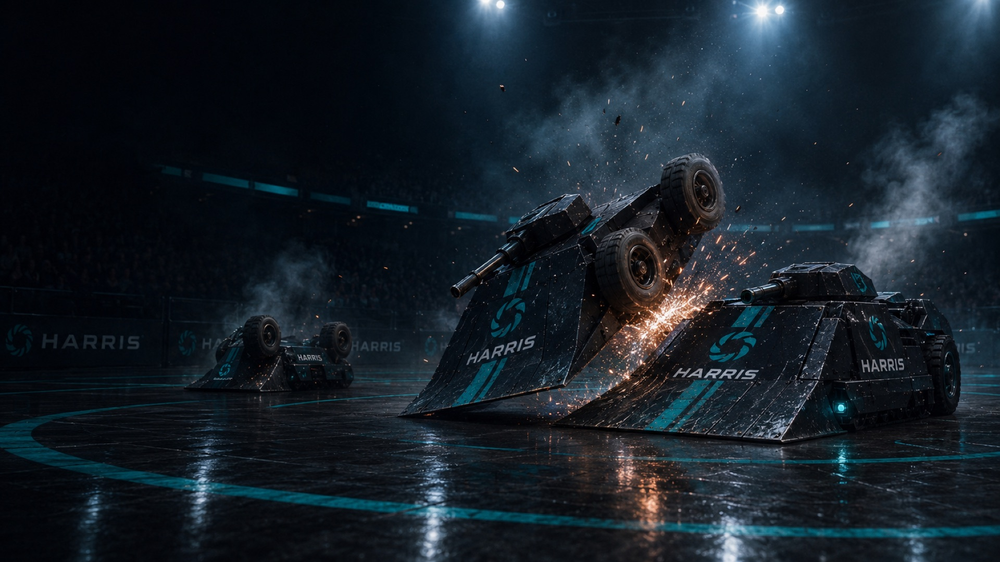

# Robot Wars: the AI build-off



Design a combat robot in one Python file, build its brain with Claude Code (or by hand), then watch it fight in a 3D broadcast arena on the big screen. Pure Python standard library. No installs, no dependencies, fully offline.

Built for the Harris all-hands in July 2026: 41 colleague-built bots fought a live free-for-all and 16 teams ran a knockout bracket. Public now so anyone can run their own.

## Why this exists

This is a Claude Code workshop wearing a robot costume. The loop players practice is the real skill: describe an idea in plain English, let the agent build it, test it, read what actually happened, refine. The game is deliberately full of trade-offs and chaos (shots miss, guns jam, robots get flipped wheels-up) so the winning move is never "max the stats". In playtesting, the biggest, tankiest build lost 7 out of 10 matches to a mid-size bot with a smarter plan. Thinking wins. That is the point.

## 60-second start

```
git clone https://github.com/ao92265/robot-wars-kit.git
cd robot-wars-kit
python3 arena.py        # Windows: py arena.py
```

That runs the starter robot against the practice dummies, animated right in your terminal. Any recent Python 3 works.

**Windows:** use Windows Terminal or the VS Code terminal (the old cmd.exe mangles the display). No Python at all? "Python 3.12" is free on the Microsoft Store and needs no admin rights.

## You only edit one file: `my_bot.py`

- `LOADOUT`, the machine: spend 12 points across `hp / speed / damage / range / special / agility`, plus three free archetype picks with real trade-offs: `size` (small / medium / large), `gun` (laser / cannon / shotgun), `engine` (standard / sprint / tank / hover)
- `APPEARANCE`, the paint: your colours and spinner shape on the big screen
- `decide(view)`, the brain: your strategy, called once per tick

Arsenal: your gun, rockets (travel + splash, can flip), mines (proximity, can flip), dash. Powerup crates on the big maps. Cover walls block shots. Shots can miss, guns can jam, blasts can flip you wheels-up and helpless. The real game: find the dirtiest legal strategy.

Quick reference: **`GUIDELINES.md`**. Every knob and trade-off table: **`CUSTOMIZE.md`**. Four contrasting builds to copy: **`examples/`**. Have Claude Code build it for you from one sentence: **`PROMPT.md`**.

## Test and tune

| Command | Does |
|---|---|
| `python3 arena.py` | starter vs all dummies, animated |
| `python3 arena.py --vs sniper` | fight one dummy (`duck`, `chaser`, `sniper`, `bomber`, `trapper`) |
| `python3 arena.py --vs sniper --best-of 20` | win-rate over N matches |
| `python3 arena.py --fast` | skip animation, just the result |
| `python3 arena.py --check` | is my loadout legal? |
| `python3 arena.py --replay match.jsonl` | replay a recorded match |
| `python3 arena.py --map colosseum` | bigger arena (`classic`, `arena`, `colosseum`, `gauntlet`, `pillars`) |

The bigger maps bite back: lava, water, ice, pits, powerup crates, a floor flipper that hurls robots wheels-up and a spinning turntable. Your bot sees every hazard in `view.arena.hazards`; dodging (or abusing) them is legal.

## Run a tournament

One machine runs the whole show and venue internet is never required. The full
playbook, with the T-minus checklist and a failure drill for everything that can
go wrong on stage, is **`ORGANISER-RUNBOOK.md`**. The short version:

```
python3 -m tournament.doctor                                   # preflight: green board or fix it
python3 -m tournament.event create  myevent --format ffa --seed 1
python3 -m tournament.event register myevent "Team A" "Team B"  # tokens, shown once
python3 -m tournament.event serve   myevent                     # teams submit, watch /status
python3 -m tournament.event snapshot myevent                    # CLOSE submissions, immutable
python3 -m tournament.event run     myevent                     # heats or bracket, records every match
python3 -m tournament.event closeout myevent                    # archive + sha256 manifest
open tournament/visual/arena.html                               # big screen: drag any recording in
```

`--format ffa` is heats plus a final, `bracket` is a 1v1 knockout.

- **Nothing can be lost.** Every accepted submission is journaled append only with a
  receipt. A wrong token gets a 409 and the previous file is untouched. `serve --open`
  drops the token check for a single room LAN event and keeps the journal.
- **The snapshot is the roster.** After `snapshot`, late submissions do not exist for
  this event. Closeout verifies the hashes and blocks on a hand edit.
- **The recording is the result.** Match seeds are derived from team identity and stored
  in the results. Disputes are settled by replaying, never by re running.
- **A crash is survivable.** `run --resume` reloads completed matches and runs the rest
  with identical seeds. A bot that hangs or crashes has its last action substituted and
  the match continues.
- Matches run headless in well under a second each. Pre run the whole thing on the
  morning: the recordings are your fallback if anything misbehaves live.
- Balance tuning lives in `engine/config.py` (budget, stat curves, speeds, arena size).

## Run your own event

The 90 minute shape that worked for 80 people. The one thing worth copying exactly is
the middle: **everyone builds their own bot, then each table plays off to pick the one
that represents them.** Nobody sits idle watching someone else type, and the selection
pressure is real.

| Clock | Minutes | What happens |
|---|---|---|
| 09:30 | 12 | Talk and demo match |
| 09:42 | 5 | Brief and rules |
| 09:47 | 5 | Kit checkpoint: everyone shows `--check` READY |
| 09:52 | 30 | Build your own bot |
| 10:22 | 10 | Table playoff, `arena.py --vs-file rival.py` |
| 10:32 | 3 | Lock in: each table hands in its champion |
| 10:35 | 15 | Knockout bracket on the big screen |
| 10:50 | 5 | Awards |
| 10:55 | 5 | Buffer |

Non engineers are not passengers: the loadout and the archetype picks are plain English
decisions with real trade offs, and the strategy is a paragraph before it is code.

Send everyone the kit link the day before, not just one person per table. Run the kit
checkpoint before the build starts rather than after, so a laptop with no working Python
is found while there is still time to fix it.

## Layout

```
my_bot.py            <- the only file players edit
arena.py             <- run / check / submit / replay
GUIDELINES.md        <- 2-minute cheat sheet
CUSTOMIZE.md         <- every knob: stats, guns, engines, mishaps, powerups
examples/            <- four contrasting builds to copy and tweak
PROMPT.md            <- paste into Claude Code
engine/              <- the game: sim, view, sandbox, render
tournament/          <- bracket runner, submit server, 3D visualiser
tests/               <- engine tests (python3 tests/test_engine.py)
ORGANISER-RUNBOOK.md <- running the show: checklist, drills, escalation
```

Terminal animation needs nothing extra (ASCII). `pygame` is optional and only used by organisers.
